# DDMC (Doki Doki Music Companion)

A high-fidelity, zero-telemetry Android music player and desktop audio suite powered by the **Cavifax**, **Chris Chan**, **Aimep3**, and **Bagresuko** engines, featuring a real-time native C++ FFT spectrum engine, dynamic per-track video covers, interactive 2D/3D Non-Chibi and Chibi Doki companions with Blender 5.2 skeletal animations, glassmorphic home screen widgets, adaptive stage layouts, and offline DSP audio processing.

---

## Downloads and Releases

| Edition | Application ID | Target | Description | Download Link |
|---|---|---|---|---|
| **DDMC (v2.1.0)** | `com.cavifax.bagresuko` | Android 8.0+ | Official release with Cavifax/Chris Chan/Aimep3/Bagresuko suite, storage video player section, default media player intent filters, 2D/3D companion mode switch with stage positioning and speed sliders, expressive 3D arm/leg idol dance choreography, and custom Yuri rig. | [Download DDMC.apk](https://github.com/MegatronF0id5la4yer/DDMC/releases/download/v2.1.0/DDMC.apk) |
| **DDMC C/C++ Desktop Engine** | CLI Executable | Windows / Linux / macOS | Standalone zero-GC command-line player with miniaudio, Cooley-Tukey Radix-2 FFT, and ANSI TrueColor visualizer. | [Source in `ddmc_cpp/`](./ddmc_cpp) |

All official releases, changelogs, and binary assets are published on [GitHub Releases](https://github.com/MegatronF0id5la4yer/DDMC/releases).

---

## Visual Showcase (Google Pixel Capture)

### Standard Edition Experience

| Landscape Stage (Column Visualizer) | Portrait Stage (Radial Pulse + Blur) |
|:---:|:---:|
| 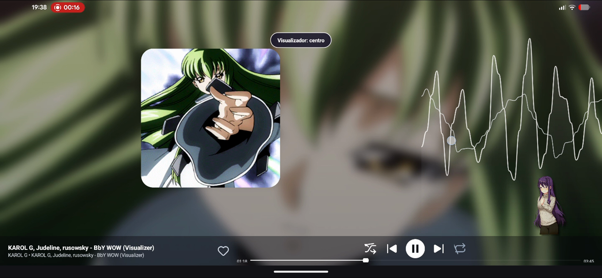 | 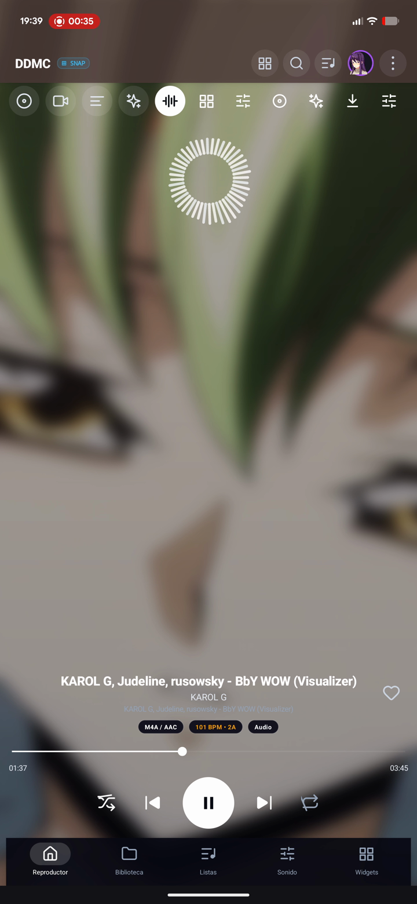 |
| Centered artwork card with side column visualizer and Yuri companion | Real-time Gaussian blur backdrop with 360-degree radial pulse |

| Floating Artwork & Waveform | Per-Track DSP Audio Engine |
|:---:|:---:|
| 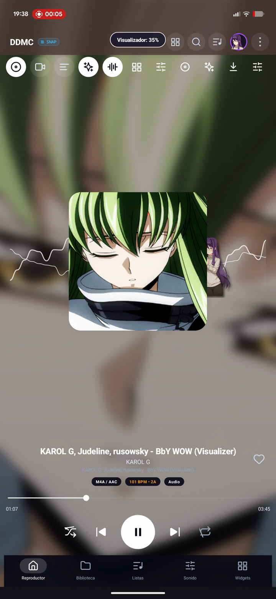 | 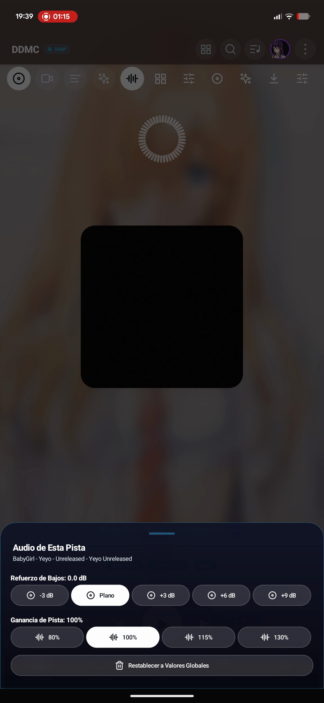 |
| Floating rounded square artwork card with live oscilloscope wave | Cavifax bass boost and digital gain customization sheet |

---

## Characters and Companions Showcase

DDMC includes built-in interactive companions that celebrate and dance to real audio beats detected by the native C++ engine, with a clean, streamlined selector (`Natsuki`, `Monika`, `Sayori`, `Yuri`, `Bocchi`, `Konata` in `Casual | Uniforme | Chibi`).

### Non-Chibi 3D HD Dokis (Blender 5.2 Full-Scale Rig & Dance Animations)

All 7 full-scale Non-Chibi HD Doki outfits (`Uniforme` and `Casual`) are rigged and animated in 3D via `uv` and headless **Blender 5.2** (`scripts/build_3d_hd_dokis.py` + `scripts/blender_rig_and_render_hd.py`) with 6-bone anatomical armatures (`root`, `hips`, `spine`, `chest`, `head`, `arms`), 5 full 3D animations (`idle`, `walk`, `dance`, `jump`, `action`), and exported glTF 2.0 (`.glb`) models:

| Character & Outfit | 3D HD Render (Blender 5.2) | 3D HD Dance Animation | 3D glTF Model (`.glb`) |
|---|:---:|:---:|:---:|
| **Monika (Uniforme)** |  | 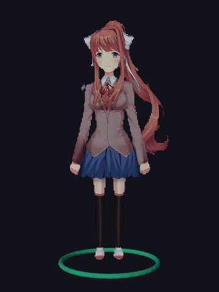 | [`monika_school_3d.glb`](./docs/models3d/monika_school_3d.glb) |
| **Sayori (Uniforme)** |  | 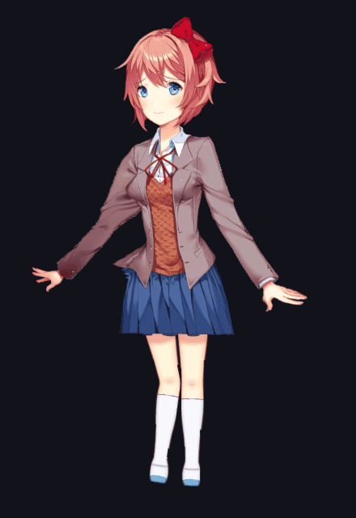 | [`sayori_school_3d.glb`](./docs/models3d/sayori_school_3d.glb) |
| **Sayori (Casual)** | 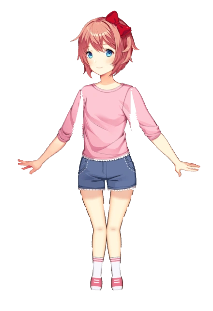 | 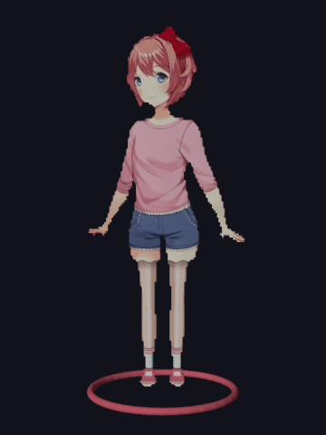 | [`sayori_casual_3d.glb`](./docs/models3d/sayori_casual_3d.glb) |
| **Natsuki (Uniforme)** |  | 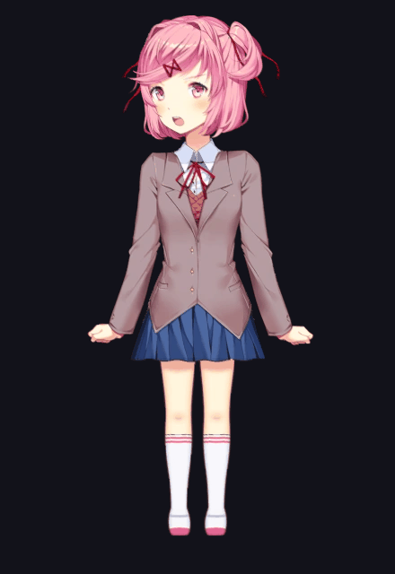 | [`natsuki_school_3d.glb`](./docs/models3d/natsuki_school_3d.glb) |
| **Natsuki (Casual)** |  | 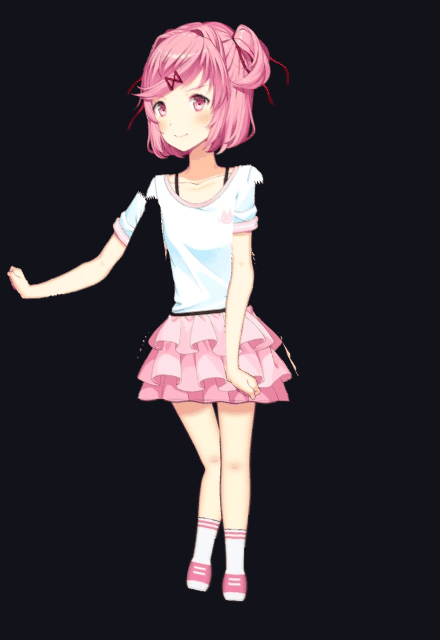 | [`natsuki_casual_3d.glb`](./docs/models3d/natsuki_casual_3d.glb) |
| **Yuri (Uniforme)** |  | 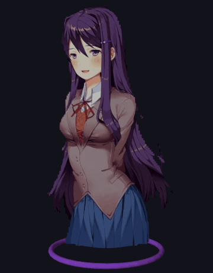 | [`yuri_school_3d.glb`](./docs/models3d/yuri_school_3d.glb) |
| **Yuri (Casual)** |  |  | [`yuri_casual_3d.glb`](./docs/models3d/yuri_casual_3d.glb) |

### Chibi & Guest 3D Characters (Blender 5.2 + `uv` Skeletal Rig & Animations)

All 6 companions also include Chibi/Guest 3D rigged meshes generated via `uv` and headless **Blender 5.2** (`scripts/build_3d_characters.py` + `scripts/blender_rig_and_render.py`):

| Character | 3D Render (Blender 5.2) | 3D Dance Animation | 3D glTF Model (`.glb`) |
|---|:---:|:---:|:---:|
| **Monika** |  |  | [`monika_3d.glb`](./docs/models3d/monika_3d.glb) |
| **Sayori** |  |  | [`sayori_3d.glb`](./docs/models3d/sayori_3d.glb) |
| **Natsuki** |  |  | [`natsuki_3d.glb`](./docs/models3d/natsuki_3d.glb) |
| **Yuri** |  |  | [`yuri_3d.glb`](./docs/models3d/yuri_3d.glb) |
| **Bocchi** | 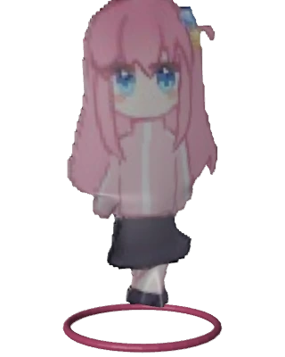 | 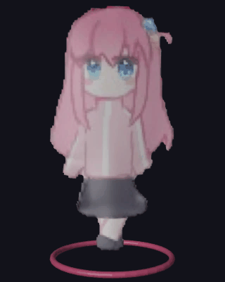 | [`bocchi_3d.glb`](./docs/models3d/bocchi_3d.glb) |
| **Konata** |  | 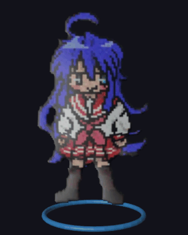 | [`konata_3d.glb`](./docs/models3d/konata_3d.glb) |

### 2D Sprite Variants

| Character | Classic | Casual | School | Snug |
|---|:---:|:---:|:---:|:---:|
| **Monika** |  | - |  |  |
| **Sayori** |  |  |  |  |
| **Natsuki** |  |  |  |  |
| **Yuri** |  |  |  |  |

---

## Core Architecture and Features

### 1. Cavifax / Chris Chan / Aimep3 / Bagresuko Suite
- **Cavifax Audio & Widget Engine (`CavifaxAudioProcessor`, `CavifaxWidgetProvider`, `CavifaxStore`)**: Direct PCM audio processor, custom-rendered glassmorphic home screen widget with true rounded corners, ambient equalizer wave bars, and interactive 3D Doki companion (`ACTION_DOKI_TAP`).
- **Chris Chan Suite (`ChrisChanSuite`, `ChrisChanEqualizerBuilder`, `ChrisChanImporter`)**: Multi-band equalizer, backup/playlist importer, queue sheet, sleep timer, and speed/pitch controls.
- **Aimep3 Modals (`Aimep3Modals`)**: Track lyrics, metadata editor, and audio analysis modals.
- **Bagresuko Engine (`BagresukoEngine`, `BagresukoSettingsBuilder`)**: Lossless library tools, high-resolution audio scanner, and studio settings.

### 2. Real-Time Native C++ FFT Engine
- **Direct PCM Pipeline Integration**: Audio buffers are intercepted directly from the player software decoder pipeline via `CavifaxAudioProcessor` and dispatched to the native C++ engine (`ddmc_fft.cpp`).
- **Zero OS Visualizer Dependency**: Bypasses Android OS `android.media.audiofx.Visualizer` limitations, hardware DSP offload silences, and audio record permission restrictions.
- **Cooley-Tukey Radix-2 FFT**: Thread-safe spectral processing with Hann windowing, 44 logarithmic frequency bins, dynamic attack/decay smoothing, and floating peak caps with gravity physics.
- **Real-Time Oscilloscope**: Continuous 128-sample raw PCM waveform extraction directly feeding dual neon wave renderers.

### 3. 10 High-Precision Audio Visualizer Modes
1. **Mirror Spectrum Pro**: Dual-sided logarithmic frequency spectrum with floating peak pills and gravity decay.
2. **Dual Neon Oscilloscope**: Real-time cubic spline interpolated waveform renderer.
3. **Radial 360 Pulse**: Circular pulse visualizer with beat-reactive radius modulation and sub-bass resonance.
4. **Spectral Waterfall**: Time-decay heat-map spectrogram with rolling frequency history.
5. **Studio Hybrid**: Combined dual waveform and spectrum analysis.
6. **Digital VU LED Matrix**: Discrete multi-segment VU meter with green/yellow/red peak warning thresholds.
7. **Cosmic Starfield**: Audio-driven warp speed particle field.
8. **Cyberpunk Glitch Wave**: Segmented glitch aesthetic reacting to high-frequency transients.
9. **Vortex Tunnel 3D**: Infinite depth perspective tunnel modulated by bass energy.
10. **Liquid Aurora**: Flowing organic fluid ribbons with harmonic frequency dispersion.

- **Sensibilidad del Espectro Ajustable (25% a 300%)**: Control deslizante continuo (`SeekBar`) con feedback visual en tiempo real y 4 presets rápidos (`Baja 50%`, `Normal 100%`, `Alta 175%`, `Extrema 250%`) accesible desde el menú de la ventana del visualizador y desde el panel de personalización del reproductor, aplicando escalado de ganancia adaptativo tanto en el motor FFT nativo en C++ (`FftAnalyzer`) como en el renderizador Kotlin (`VisualizerView`).

### 4. Sound DSP Engines (Offline, Zero Cloud)
- **Doomentio Audio Engine**: Software mono downmix, stereo balance pan, and independent digital gain per track.
- **Cavifax Bass Booster**: 1st-order IIR low-pass filter with 150Hz cutoff frequency boost tailored for mobile and high-fidelity headphones.
- **Dante Studio Equalizer**: Multi-band graphic equalizer with high-precision Q factor controls.
- **Skiso Virtualizer & Reverb**: Spatial audio widening and room acoustics simulation.
- **Jerry Engine Pro**: Dynamic loudness compensation, anti-clipping limiter, and OTA self-updater.

---

## Building from Source

### Prerequisites
- JDK 17
- Android SDK (API 34, Build Tools 34.0.0)
- Android NDK (r25c or newer for C++ compilation)
- CMake 3.22.1+

### Android Builds

Clone the repository and enter the Android project root:

```bash
cd android_app
```

#### Build APK:
```bash
./gradlew assembleStandardDebug
# Output: android_app/app/build/outputs/apk/standard/debug/app-standard-debug.apk
```

---

## Privacy and Offline Philosophy

DDMC is built on a strict privacy model:
- **100% Offline**: Operates entirely on the local device without requiring an account, login, or cloud connection.
- **Zero Telemetry**: No crash analytics, usage tracking, installation pings, or device fingerprinting.
- **Zero Third-Party Advertising SDKs**: No ad networks, tracking pixels, or data collection libraries.

---

## License

This project is licensed under the MIT License.
