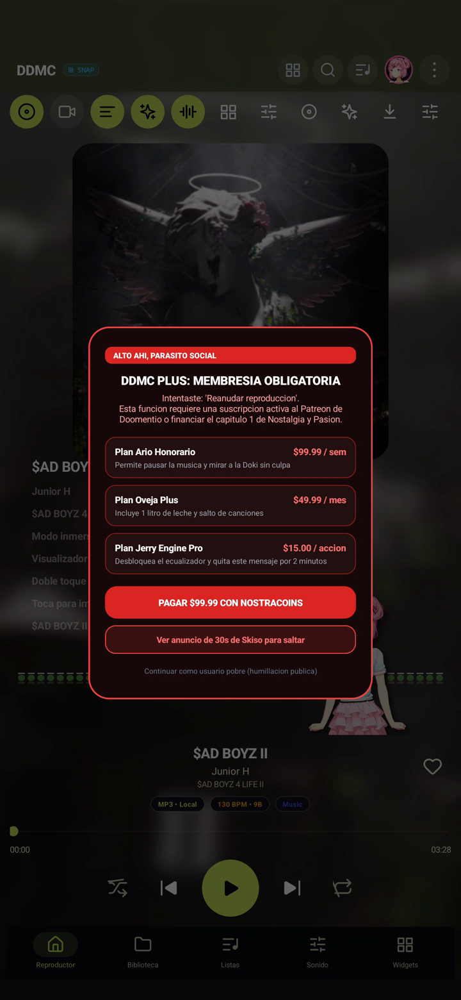
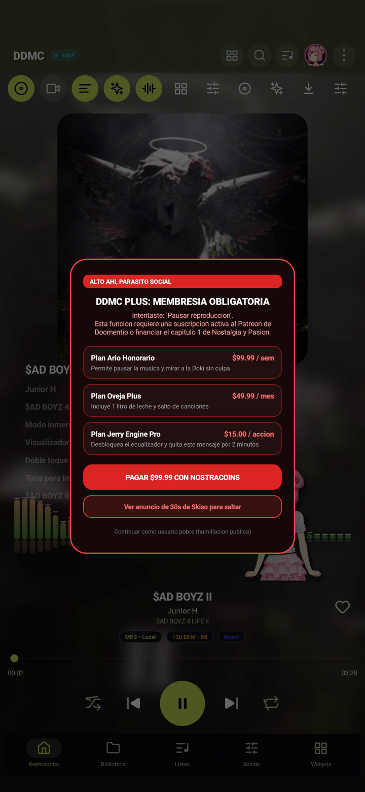
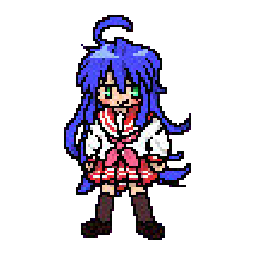
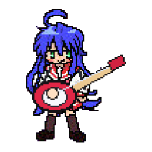

# DDMC (Doki Doki Music Companion)

A high-fidelity, zero-telemetry Android music player and desktop audio suite featuring a real-time native C++ FFT spectrum engine, dynamic per-track video covers, interactive Doki companions with physics, adaptive stage layouts, and offline DSP audio engines.

---

## Downloads and Releases

| Edition | Application ID | Target | Description | Download Link |
|---|---|---|---|---|
| **DDMC Standard Edition (v2.0.5)** | `com.sonora.music` | Android 8.0+ | Official clean release with zero interruptions, full DSP suite, 10 visualizers, and Doki companion. | [Download DDMC.apk](https://github.com/MegatronF0id5la4yer/DDMC/releases/download/v2.0.5/DDMC.apk) |
| **DDMC Version Troll (v2.0.5)** | `com.sonora.music.troll` | Android 8.0+ | Satirical edition with comic micro-paywalls (Plan Ario Honorario, NostraCoins, Oveja Plus) between actions and poverty bypass. | [Download DDMC_Version_Troll.apk](https://github.com/MegatronF0id5la4yer/DDMC/releases/download/v2.0.5/DDMC_Version_Troll.apk) |
| **DDMC C/C++ Desktop Engine** | CLI Executable | Windows / Linux / macOS | Standalone zero-GC command-line player with miniaudio, Cooley-Tukey Radix-2 FFT, and ANSI TrueColor visualizer. | [Source in `ddmc_cpp/`](./ddmc_cpp) |

Both Android editions can be installed simultaneously on the same device without package or provider collisions.

All official releases, changelogs, and binary assets are published on [GitHub Releases](https://github.com/MegatronF0id5la4yer/DDMC/releases).

---

## Visual Showcase (Google Pixel Capture)

### Standard Edition Experience

| Landscape Stage (Column Visualizer) | Portrait Stage (Radial Pulse + Blur) |
|:---:|:---:|
|  |  |
| Centered artwork card with side column visualizer and Yuri companion | Real-time Gaussian blur backdrop with 360-degree radial pulse |

| Floating Artwork & Waveform | Per-Track DSP Audio Engine |
|:---:|:---:|
|  |  |
| Floating rounded square artwork card with live oscilloscope wave | Cavifax bass boost and digital gain customization sheet |

---

### Troll Edition (Micro-Paywall Interceptions)

| Paywall Modal Interceptor | 30s Mock Ad Countdown | Action Interception Toast |
|:---:|:---:|:---:|
|  |  |  |
| Doomentio Patreon, NostraCoins & comedy tiers | Colchones Perez mock ad timer | Intercepts play/pause, skips, and sound settings |

---

## Characters and Companions Showcase

DDMC includes built-in interactive companions that celebrate and dance to real audio beats detected by the native C++ engine.

### Doki Doki Literature Club

| Character | Classic | Casual | School | Snug |
|---|:---:|:---:|:---:|:---:|
| **Monika** |  | - |  |  |
| **Sayori** |  |  |  |  |
| **Natsuki** |  |  |  |  |
| **Yuri** |  |  |  |  |

### Guest Companions

| Character | Stand Pose | Guitar Action | Origin |
|---|:---:|:---:|---|
| **Bocchi (Hitori Gotoh)** |  |  | Bocchi the Rock! |
| **Konata Izumi** |  |  | Lucky Star |

### 3D Characters (Blender 5.2 + `uv` Skeletal Rig & Animations)

All 6 companions include 3D rigged meshes generated from their cleaned sprites via `uv` and headless **Blender 5.2** (`scripts/build_3d_characters.py` + `scripts/blender_rig_and_render.py`), complete with skeletal armature animations (`idle`, `walk`, `dance`, `jump`, `action`) and exported glTF 2.0 (`.glb`) 3D models:

| Character | 3D Render (Blender 5.2) | 3D Dance Animation | 3D glTF Model (`.glb`) |
|---|:---:|:---:|:---:|
| **Monika** |  |  | [`monika_3d.glb`](./docs/models3d/monika_3d.glb) |
| **Sayori** |  |  | [`sayori_3d.glb`](./docs/models3d/sayori_3d.glb) |
| **Natsuki** |  |  | [`natsuki_3d.glb`](./docs/models3d/natsuki_3d.glb) |
| **Yuri** |  |  | [`yuri_3d.glb`](./docs/models3d/yuri_3d.glb) |
| **Bocchi** |  |  | [`bocchi_3d.glb`](./docs/models3d/bocchi_3d.glb) |
| **Konata** |  |  | [`konata_3d.glb`](./docs/models3d/konata_3d.glb) |


---

## Core Architecture and Features

### 1. Real-Time Native C++ FFT Engine
- **Direct PCM Pipeline Integration**: Audio buffers are intercepted directly from the player software decoder pipeline via `SonoraAudioProcessor` and dispatched to the native C++ engine (`ddmc_fft.cpp`).
- **Zero OS Visualizer Dependency**: Bypasses Android OS `android.media.audiofx.Visualizer` limitations, hardware DSP offload silences, and audio record permission restrictions.
- **Cooley-Tukey Radix-2 FFT**: Thread-safe spectral processing with Hann windowing, 44 logarithmic frequency bins, dynamic attack/decay smoothing, and floating peak caps with gravity physics.
- **Real-Time Oscilloscope**: Continuous 128-sample raw PCM waveform extraction directly feeding dual neon wave renderers.

### 2. 10 High-Precision Audio Visualizer Modes
1. **Mirror Spectrum Pro**: Dual-sided logarithmic frequency spectrum with floating peak pills and gravity decay.
2. **Dual Neon Oscilloscope**: Real-time cubic spline interpolated waveform renderer.
3. **Radial 360 Pulse**: Circular pulse visualizer with beat-reactive radius modulation and sub-bass resonance.
4. **Spectral Waterfall**: Time-decay heat-map spectrogram with rolling frequency history.
5. **Studio Hybrid**: Combined dual waveform and spectrum analysis.
6. **Digital VU LED Matrix**: Discrete multi-segment VU meter with green/yellow/red peak warning thresholds.
7. **Cosmic Starfield**: Audio-driven warp speed particle field.
8. **Cyberpunk Glitch Wave**: Segmented glitch aesthetic reacting to high-frequency transients.
9. **Vortex Tunnel 3D**: Infinite depth perspective tunnel modulated by bass energy.
10. **Liquid Aurora**: Flowing organic fluid ribbons with harmonic frequency dispersion.

### 3. Adaptive Stage Layout and Background Controls
- **Background Engine**:
  - **Material Solid**: Pure black AMOLED or deep slate tone for maximum battery efficiency.
  - **Album Cover with Real-Time Gaussian Blur**: Dynamic backdrop derived from track artwork with live blur radius and opacity sliders.
- **Floating Artwork Card**: Centered square album art with smooth 24dp rounded corners and elevation shadows.
- **Landscape Layout Flexibility**:
  - Visualizer can be positioned as a dedicated side column (Left or Right) or docked (Bottom, Center, Top).
  - Eliminates overlap between radial/circular visualizers and the album art card in horizontal tablet and landscape phone orientations.

### 4. Doki Doki Companion Engine
- **Characters**: Natsuki, Sayori, Yuri, Monika, Bocchi, and Konata.
- **Beat and Kinetic Physics**: Companions jump, dance, and celebrate in sync with real bass beat drops detected in C++.
- **Mounting Options**: Companions can sit or dance directly on the spectrum visualizer or wander along the stage dock.

### 5. Sound DSP Engines (Offline, Zero Cloud)
- **Doomentio Audio Engine**: Software mono downmix, stereo balance pan, and independent digital gain per track.
- **Cavifax Bass Booster**: 1st-order IIR low-pass filter with 150Hz cutoff frequency boost tailored for mobile and high-fidelity headphones.
- **Dante Studio Equalizer**: Multi-band graphic equalizer with high-precision Q factor controls.
- **Skiso Virtualizer & Reverb**: Spatial audio widening and room acoustics simulation.
- **Jerry Engine Pro**: Dynamic loudness compensation and anti-clipping limiter.

### 6. Product Flavors: Standard vs Troll Edition
The project is organized into two Gradle product flavors under the `edition` dimension:
- **`standard`**: `applicationId = "com.sonora.music"`, clean production interface.
- **`troll`**: `applicationIdSuffix = ".troll"`, integrates `FakePaywall.kt` which comically intercepts playback actions (play/pause, skip, shuffle, favorite, equalizer) with parody paywall tiers (Plan Ario Honorario, Plan Oveja Plus, Plan Jerry Engine Pro), NostraCoins button, simulated 30-second ad countdown, and poverty bypass button.

### 7. Hardware Optimization Engine (Potato to Ultra)
- **Potato Mode (30 FPS)**: Halves FFT calculations (22 bands), enforces 16-bit RGB_565 bitmap decoding to cut memory footprint by 50%, throttles particle spawning, and caps rendering to 30 FPS for budget/older devices.
- **Balanced Mode (60 FPS)**: Standard high-fidelity smooth rendering.
- **Ultra Mode (120 FPS)**: Uncapped high-refresh rate mode for flagship screens.

### 8. Dynamic Per-Track Video Covers
- Plays looped MP4 and GIF video covers per individual track or globally.
- Dynamic matrix center-crop scaling eliminates black bars across vertical 9:16, 16:9, 4:3, and 1:1 aspect ratios.
- Internal storage isolation ensures smooth playback without Scoped Storage permission timeouts.

### 9. Automatic In-App OTA Self-Updater
- Checks for new releases and updates directly from the GitHub repository on application startup.
- Downloads the latest package in the background and prompts the Android package installer for one-tap updates without requiring a PC or ADB connection.

### 10. Standalone C/C++ Desktop Engine (`ddmc_cpp`)
- Independent, high-performance C/C++ desktop version:
  - Powered by `miniaudio.h` (single-header C, zero third-party library dependencies).
  - Cooley-Tukey Radix-2 FFT analyzer with Hann windowing.
  - Synced LRC lyric reader.
  - ANSI TrueColor terminal renderer with non-flickering double buffering.
  - Uses less than 10 MB RAM and zero garbage collection overhead.

---

## Building from Source

### Prerequisites
- JDK 17
- Android SDK (API 34, Build Tools 34.0.0)
- Android NDK (r25c or newer for C++ compilation)
- CMake 3.22.1+

### Android Builds

Clone the repository and enter the Android project root:

```bash
cd android_app
```

#### Build Standard Edition (Clean):
```bash
./gradlew assembleStandardDebug
# Output: android_app/app/build/outputs/apk/standard/debug/app-standard-debug.apk
```

#### Build Troll Edition (Satirical Paywall):
```bash
./gradlew assembleTrollDebug
# Output: android_app/app/build/outputs/apk/troll/debug/app-troll-debug.apk
```

#### Build Both Simultaneously:
```bash
./gradlew assembleStandardDebug assembleTrollDebug
```

### C/C++ Desktop Engine

Requirements: C++17 compiler (GCC, Clang, or MSVC) and CMake.

```bash
cd ddmc_cpp
mkdir build
cd build
cmake ..
cmake --build . --config Release
```

Or using Make on Linux / macOS:

```bash
cd ddmc_cpp
make
```

---

## Privacy and Offline Philosophy

DDMC is built on a strict privacy model:
- **100% Offline**: Operates entirely on the local device without requiring an account, login, or cloud connection.
- **Zero Telemetry**: No crash analytics, usage tracking, installation pings, or device fingerprinting.
- **Zero Third-Party Advertising SDKs**: No ad networks, tracking pixels, or data collection libraries.

---

## License

This project is licensed under the MIT License.
